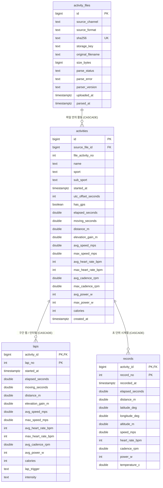

# 활동 데이터 스키마 설계안

## 모델 매핑 기준

FIT 및 GPX 데이터를 공통 활동·랩·시계열 모델로 통합 매핑한다. (독립 웨이포인트 `wpt` 및 경로 `rte` 제외)

| 내부 모델 | FIT 매핑 | GPX 매핑 | 비고 |
| --- | --- | --- | --- |
| `activity_files` | 원본 파일 메타데이터 | 원본 파일 메타데이터 | 수집 경로(`upload`/`dropbox`), SHA-256 중복 방지 |
| `activities` | Activity / Session 메시지 | 트랙 (`trk`) | 단일 운동 활동 요약 및 통계 (`has_gps` 포함) |
| `laps` | Lap 메시지 | - | 장치/수동 랩(`lap_trigger`) 및 인터벌(`intensity`) |
| `records` | Record 메시지 | 트랙포인트 (`trkpt`) | 초 단위 시계열 표본 |

> 📌 **참고 문서**: [Garmin FIT Activity 문서](https://developer.garmin.com/fit/articles/file-types/activity.html), [GPX 1.1 스키마](https://www.topografix.com/gpx/1/1/)

## 데이터베이스 및 스키마

- **데이터베이스**: `fitlab`
- **스키마**: `core` (초기 마이그레이션: `0001_initial_activity_schema.up.sql`)
- **연결 설정**: Go 애플리케이션 연결 시 `search_path=core` 적용
- **형식 감지**: `activity_files.source_format`에 파일 내용 검사 결과(`fit` 또는 `gpx`) 저장

## 초기 FIT·GPX 가져오기 ERD

## 관계 및 저장 규칙

- **`activity_files`**: 파일 메타데이터(수집 경로 `source_channel`, 해시 `sha256`, 형식, 파싱 상태 등) 관리. `sha256` 유일 제약으로 동일 파일 중복 방지. 원본 스토리지 경로는 `storage_key`에 기록 (DB bytea 저장 안 함).
- **`activities`**: `(source_file_id, file_activity_no)` 유일. `source_file_id`에 `ON DELETE CASCADE`를 적용해 원본 파일 행 삭제 시 활동·랩·레코드가 연쇄 삭제되고 동일 파일 재업로드가 가능하도록 구성. 야외 GPS 활동 여부는 `has_gps`로 즉시 판별.
- **`laps`**: `(activity_id, lap_no)` 복합 기본키(PK)를 사용하여 불필요한 대리키 인덱스를 제거. FIT 파일에 기록된 랩 생성 방식(`lap_trigger`: `manual`, `distance`, `time`, `session_end` 등)과 인터벌 강도(`intensity`: `warmup`, `active`, `recovery`, `rest`, `cooldown`)를 함께 보존하여, 수동/인터벌 랩과 `records` 기반 계산 스플릿(1km 등)을 모두 표시할 수 있도록 구성.
- **`records`**: `(activity_id, record_no)` 복합 기본키(PK) 하나로 대량 시계열 데이터(Bulk Insert) 시 인덱스 갱신 부하와 디스크 사용량을 최소화하고, 활동별 조회 및 간격 다운샘플링(`record_no % N = 0`)을 단일 PK 인덱스로 처리.
- **유효성 검증**: 상태·좌표·수치 범위 검증은 Go 저장 계층이 담당하며, DDL은 PK, FK, NOT NULL 등 핵심 무결성 제약만 유지.

## 단위 및 인덱스

- **표준 단위**: 시간(UTC `timestamptz`), 거리/고도(m), 속도(m/s), 기온(°C), 심박(bpm), 케이던스(rpm), 파워(W), 좌표(십진 도)
- **주요 인덱스**:
  - `activity_files`: `id` (PK), `sha256` (Unique)
  - `activities`: `id` (PK), `(source_file_id, file_activity_no)` (Unique), `started_at DESC`, `(sport, started_at DESC)`
  - `laps`: `(activity_id, lap_no)` (복합 PK)
  - `records`: `(activity_id, record_no)` (복합 PK)

## 현재 스키마 미반영 FIT 속성 (향후 확장 레퍼런스)

현재 `core` 스키마는 시각화 및 훈련 분석에 필수적인 핵심 지표 위주로 경량화되어 있으며, FIT 프로토콜(`FileId`, `DeviceInfo`, `Session`, `Lap`, `Record`, `Event`, `WorkoutStep`)에 존재하는 아래 속성들은 향후 고도화 단계에서 필요에 따라 컬럼 또는 테이블로 추가할 수 있다.

### 1. 기기 및 파일 생성 메타데이터 (`FileId`, `DeviceInfo`, `FileCreator`)
| FIT 필드명 | 설명 | 활용처 |
| --- | --- | --- |
| `manufacturer`, `product` (`garmin_product`) | 기록 기기 제조사 및 모델 식별자 (예: Garmin, Apple Watch, Coros) | 활동별 사용 장비 표시 및 기기별 통계 |
| `software_version` | 기기 펌웨어 또는 기록 앱(WorkOutDoors, HealthFit 등) 버전 | 파서 호환성 추적 |
| `serial_number`, `device_index` | 연결된 외부 센서(심박계, 파워미터, 스트라이드 센서) 식별 | 센서 연결 내역 확인 |

### 2. 러닝 다이내믹스 (Running Dynamics — `Session`, `Lap`, `Record`)
| FIT 필드명 | 단위 | 설명 |
| --- | --- | --- |
| `step_length` / `avg_step_length` | mm | 보폭 (한 걸음당 이동 거리) |
| `vertical_oscillation` / `avg_vertical_oscillation` | mm | 수직 진폭 (달릴 때 상하 바운스 폭) |
| `vertical_ratio` / `avg_vertical_ratio` | % | 수직 비율 (보폭 대비 수직 진폭 비율, 러닝 경제성 지표) |
| `stance_time` / `avg_stance_time` | ms | 지면 접촉 시간 (GCT, Ground Contact Time) |
| `stance_time_balance` / `avg_stance_time_balance` | % | 좌/우 발 지면 접촉 밸런스 |
| `fractional_cadence` | rpm | 소수점 단위 정밀 케이던스 |

### 3. 고도·파워·생리학 및 환경 지표 (`Session`, `Lap`, `Record`)
| FIT 필드명 | 단위 | 설명 |
| --- | --- | --- |
| `total_descent` | m | 누적 하강 고도 (현재 상승 고도 `elevation_gain_m`만 저장) |
| `min_altitude`, `max_altitude` | m | 활동/랩 내 최저 및 최고 고도 |
| `grade` | % | 순간 경사도 (`Record`) |
| `total_timer_time` | s | 일시 정지를 제외한 순수 타이머 시간 (`elapsed_seconds`와 별개) |
| `normalized_power` (NP) | W | 정규화 파워 (변동성을 반영한 체감 파워) |
| `training_stress_score` (TSS), `intensity_factor` (IF) | 점수 / 비율 | 파워 기반 훈련 부하 및 강도 계수 |
| `total_training_effect`, `total_anaerobic_training_effect` | 0.0~5.0 | 기기에서 산출한 유산소·무산소 훈련 효과(TE) |
| `min_heart_rate` | bpm | 최소 심박수 |
| `avg_temperature`, `max_temperature`, `min_temperature` | °C | 세션/랩 단위 평균·최고·최저 기온 (현재 `records.temperature_c`만 저장) |
| `total_strides` / `total_cycles` | 걸음 / 회 | 총 걸음 수(스트라이드) 또는 페달 회전수 |
| `nec_lat`, `nec_long`, `swc_lat`, `swc_long` | degree | 활동 경로의 경계 상자(Bounding Box 북동·남서 좌표) |

### 4. 워크아웃 목표·이벤트 및 서드파티 확장 필드 (`WorkoutStep`, `Event`, `DeveloperData`)
| 구분 | 주요 FIT 메시지/필드 | 설명 |
| --- | --- | --- |
| **워크아웃 목표** | `Workout`, `WorkoutStep` (`target_type`, `custom_target_value_low/high`, `wkt_step_name`) | 사전 설정된 인터벌 워크아웃의 구간별 목표 페이스·심박 범위 및 단계 이름 |
| **타이머/알림 이벤트** | `Event` (`event`, `event_type`, `data`) | 타이머 시작/일시정지/종료(`start`, `stop`, `stop_all`), 자동 일시정지, 심박/페이스 경고 |
| **멀티스포츠 세션** | `Session` (다중 행) | 철인3종(수영→바꿈터→사이클→러닝) 등 한 활동 내 종목 전환 요약 |
| **개발자 확장 필드** | `DeveloperDataId`, `FieldDescription` | Stryd 파워미터(Form Power, Leg Spring Stiffness, Air Power), 코어 체온 등 CIQ 확장 데이터 |

## 후속 확장 후보

- **경량 경로 캐시 (`summary_polyline`)**: 누적 활동 수가 증가할 때 `records` 테이블을 매번 스캔하지 않고 즉시 히트맵을 렌더링하기 위한 다운샘플링 경로 캐시
- **러닝 다이내믹스 컬럼 확장**: 보폭(`step_length`), 지면 접촉 시간(`stance_time`), 수직 진폭(`vertical_oscillation`) 시각화 도입 시 `activities`, `laps`, `records`에 컬럼 추가
- **멀티스포츠 세션 (`sessions`)**: 철인3종 등 한 활동 내 다중 종목 전환이 필요할 때 확장
- **이벤트 이력 (`activity_events`)**: 타이머 정지/재개 등 세부 장치 이벤트
