# FIT 활동 데이터 스키마 설계안

## 설계 기준

Strava 공개 API는 활동 요약, 랩, 시계열 스트림을 구분합니다. Intervals.icu는 활동 스트림과 사용자 정의 인터벌·구간 통계·베스트 기록을 각각 다룹니다. RUNALYZE 문서는 HRV, 러닝 다이내믹스, 회복 시간, 장비, 태그, 날씨 기능을 설명합니다. 이 자료들은 내부 DB 구조가 아니라 공개 API와 기능 모델이므로, 아래는 해당 기능 경계를 참고한 자체 설계입니다.

- [Strava API: 활동·랩·스트림](https://developers.strava.com/docs/reference/)
- [Intervals.icu 공식 OpenAPI 문서](https://intervals.icu/api/v1/docs/)
- [RUNALYZE 기능 안내](https://github.com/Runalyze/docs/blob/master/features.rst)
- [Garmin FIT 활동 파일의 세션과 랩](https://developer.garmin.com/fit/articles/cookbook/decoding_activity_files/)

## 데이터베이스와 스키마

PostgreSQL 데이터베이스 이름은 `fitlab`이며, 앱 테이블은 그 안의 `core` 스키마에 둡니다. `DATABASE_URL`이 데이터베이스를 선택하고, 이 migration은 `core` 스키마와 그 안의 테이블을 생성합니다. `core`를 Go에서 생략하려면 연결에 `search_path=core`를 지정하고, 명시성을 원하면 쿼리에서 `core.activities`처럼 씁니다.

## 초기 FIT 가져오기 ERD

```mermaid
erDiagram
    fit_files ||--o{ activities : "파일 안의 활동"
    activities ||--o{ sessions : "FIT 세션"
    sessions ||--o{ laps : "세션 랩"
    sessions ||--o{ records : "세션 기록"
    activities ||--o{ records : "원본 시계열"
    activities ||--o{ activity_events : "FIT 이벤트"
    activities ||--o{ laps : "소속 활동"
    records ||--o{ laps : "랩 범위 레코드"

    fit_files {
        bigint id PK
        char sha256 UK
        text storage_key
        text original_filename
        bigint size_bytes
        text parse_status
        text parse_error
        text parser_version
        timestamptz uploaded_at
        timestamptz parsed_at
    }

    activities {
        bigint id PK
        bigint fit_file_id FK
        int file_activity_no
        text name
        text sport
        text sub_sport
        timestamptz started_at
        int utc_offset_seconds
        double elapsed_seconds
        double moving_seconds
        double distance_m
        double elevation_gain_m
        double avg_speed_mps
        double max_speed_mps
        int avg_heart_rate_bpm
        int max_heart_rate_bpm
        int avg_power_w
        int max_power_w
        int calories
    }

    sessions {
        bigint id PK
        bigint activity_id FK
        int session_no
        text sport
        text sub_sport
        timestamptz started_at
        double elapsed_seconds
        double moving_seconds
        double distance_m
        double elevation_gain_m
        double avg_speed_mps
        double max_speed_mps
        int avg_heart_rate_bpm
        int max_heart_rate_bpm
        double avg_cadence_rpm
        int avg_power_w
        int calories
    }

    laps {
        bigint id PK
        bigint activity_id FK
        bigint session_id FK
        int lap_no
        int start_record_no FK
        int end_record_no FK
        timestamptz started_at
        double elapsed_seconds
        double moving_seconds
        double distance_m
        double elevation_gain_m
        double avg_speed_mps
        double max_speed_mps
        int avg_heart_rate_bpm
        int max_heart_rate_bpm
        double avg_cadence_rpm
        int avg_power_w
        int calories
    }

    records {
        bigint id PK
        bigint activity_id FK
        bigint session_id FK
        int record_no
        timestamptz recorded_at
        double elapsed_seconds
        double distance_m
        double latitude_deg
        double longitude_deg
        double altitude_m
        double speed_mps
        int heart_rate_bpm
        double cadence_rpm
        int power_w
        double temperature_c
        jsonb extra_fields
    }

    activity_events {
        bigint id PK
        bigint activity_id FK
        int event_no
        timestamptz occurred_at
        double elapsed_seconds
        text event_type
        text event_group
        jsonb event_data
    }
```

## 관계와 저장 규칙

- `fit_files`는 파일 해시·이름·크기·처리 상태·파서 버전을 기록합니다. 같은 파일 하나에 여러 활동이 있을 수 있어 `activities`는 `fit_file_id` 하나만으로 유일하지 않고 `(fit_file_id, file_activity_no)`로 식별합니다. 원본 파일을 보관하면 `storage_key`에 파일 스토리지 위치를 기록하고, 파싱 결과만 보관하면 이 컬럼을 `NULL`로 둡니다. 원본을 PostgreSQL `bytea`에 넣지는 않습니다.
- `sessions`는 `(activity_id, session_no)`로 유일합니다. `laps`와 `records`는 `session_id`로 세션에 연결되고 `(activity_id, session_id)` 외래 키로 다른 활동의 세션에 잘못 연결되는 것을 막습니다. FIT 파일 손상이나 세션 정보 누락에 대비해 두 테이블의 `session_id`는 nullable입니다.
- `records`는 활동별 표본 한 건을 한 행으로 저장합니다. `(activity_id, record_no)`가 유일하며 `(activity_id, session_id, record_no)` 유일 키를 세션 범위 조회에 사용합니다. 랩의 시작·끝 레코드 번호는 `(activity_id, record_no)`를 참조하므로 존재하지 않거나 다른 활동의 레코드를 가리킬 수 없습니다. 이 참조는 파싱 트랜잭션 내에서 세션과 기록을 먼저 저장한 뒤 랩을 저장하도록 지연 검사합니다.
- `activity_events`에는 타이머 시작·정지, 랩 이벤트 등 원본 이벤트를 둡니다. `extra_fields`와 `event_data`는 아직 정식 컬럼으로 정하지 않은 FIT 개발자 정의 필드와 이벤트 데이터를 위한 JSONB 확장 지점입니다.
- 입력값의 허용 상태·숫자 범위·좌표 범위·JSON 형태 검증은 Go 저장 계층이 담당합니다. DDL에는 `CHECK`를 두지 않고 `NOT NULL`, PK, FK, 유일성으로 필수값과 관계만 보장합니다.

## 원본 FIT 파일 보관 선택

| 방식 | 장점 | 단점 |
| --- | --- | --- |
| 파일 스토리지에 원본 유지 | 파서 버그 수정 후 재파싱할 수 있고, 처음에 지원하지 않은 FIT 개발자 정의 필드도 복구할 수 있습니다. | 파일 저장 공간과 백업이 늘고, GPS가 포함된 민감한 원본을 보호·삭제하는 정책이 필요합니다. |
| 파싱 성공 후 원본 삭제 | 저장 공간과 원본 유출 위험을 줄입니다. | 스키마나 파서를 개선해도 재업로드 없이는 정보를 복구할 수 없습니다. 파싱 실패 파일은 삭제 전에 재시도해야 합니다. |

FIT는 사용자 정의 개발자 필드를 허용하므로 원본은 PostgreSQL `bytea`가 아닌 파일 스토리지에 임시 보관합니다. 보관 정책은 다음과 같습니다.

- 파싱 성공 파일은 `parsed_at`부터 30일간 보관한 뒤 삭제합니다.
- 파싱 실패 파일은 재시도할 수 있도록 업로드 시각부터 최대 30일 보관합니다.
- 파일 삭제 작업이 성공한 뒤에만 `storage_key`를 `NULL`로 바꿉니다. 삭제에 실패하면 경로를 유지해 정리 작업에서 다시 시도합니다.
- 파일을 제거해도 `fit_files` 행, SHA-256, 파일명, 크기, 파싱 상태와 오류 이력은 유지합니다.

정리 작업은 만료된 파일을 찾아 파일 스토리지에서 삭제한 뒤 DB 메타데이터를 갱신하는 방식으로 비동기 수행합니다. 따라서 FIT 원본을 재파싱할 수 있는 기간은 파싱 완료 후 30일이며, DDL의 nullable `storage_key`가 삭제 이후 상태를 표현합니다.

## 단위와 조회

시간은 UTC 기준 `timestamptz`로 저장하며 원래 로컬 시각 표시에 `utc_offset_seconds`를 사용합니다. 경과 시간은 초, 거리와 고도는 m, 속도는 m/s, 체온은 °C, 심박은 bpm, 케이던스는 rpm, 파워는 W, 좌표는 십진 도(degree)입니다. 누락 데이터는 `NULL`로 둡니다. PK는 `bigint GENERATED ALWAYS AS IDENTITY`를 사용합니다.

초기 인덱스는 `activities(started_at DESC)`, `activities(sport, started_at DESC)`, `records(activity_id, recorded_at)`, `records(activity_id, session_id, record_no)`입니다. `(activity_id, record_no)`, `(activity_id, session_no)`, `(activity_id, lap_no)`, `(activity_id, event_no)` 복합 유일 제약이 순번 조회 인덱스도 제공합니다.

## 후속 확장 후보

아래 기능은 Strava·Intervals.icu·RUNALYZE의 공개 API 및 기능을 참고한 후보이며 초기 DDL에는 만들지 않습니다.

- **HRV:** 서로 다른 샘플 구조의 RR 간격용 `hrv_samples`.
- **사용자/계산 인터벌:** FIT 장치 랩과 구분되는 `activity_intervals`. 레코드 구간을 저장할 때 `(activity_id, start_record_no)`와 `(activity_id, end_record_no)`를 `records(activity_id, record_no)`에 외래 키로 연결합니다.
- **파생 지표:** TRIMP·VO₂max·훈련 부하 등과 계산 버전을 저장하는 `activity_metrics`. 베스트 기록은 한 지표당 한 값이 아니므로 목표 거리/시간, 결과값, 시작·끝 레코드를 담는 `activity_best_efforts`로 별도 모델링합니다.
- **훈련 이력:** 태그(`tags`, `activity_tags`), 장비(`gear`, `activity_gear`), 활동 날씨(`activity_weather`), 외부 서비스 ID(`external_activity_refs`).
- **파싱 이력:** 같은 원본을 여러 파서 버전으로 재처리한 이력을 보존해야 하면 `parse_runs`를 추가하고, 활동 결과를 파싱 실행에 연결합니다.

## 구현 순서

1. `fit_files`, `activities`, `sessions`, `records`, `laps`, `activity_events` 초기 스키마를 마이그레이션합니다.
2. FIT 파일 하나가 여러 활동인 경우, 손상·누락 메시지, 다양한 레코드 간격을 포함한 테스트 데이터를 마련하고 파싱 결과 저장을 구현합니다.
3. 실제 분석·검색 기능이 요구될 때 후속 확장 테이블을 별도 마이그레이션으로 추가합니다.
