# 활동 데이터 스키마 설계안

## 모델 매핑 기준

FIT 및 GPX 데이터를 공통 활동·세션·랩·시계열 모델로 통합 매핑한다. (독립 웨이포인트 `wpt` 및 경로 `rte` 제외)

| 내부 모델 | FIT 매핑 | GPX 매핑 | 비고 |
| --- | --- | --- | --- |
| `activities` | Activity 메시지 | 트랙 (`trk`) | 파일 내 활동 단위 |
| `sessions` | Session 메시지 | 트랙 세그먼트 (`trkseg`) | 연속 운동 구간 |
| `laps` | Lap 메시지 | - | 장치/구간 랩 |
| `records` | Record 메시지 | 트랙포인트 (`trkpt`) | 초 단위 시계열 표본 |
| `activity_events` | Event 메시지 | - | 시작/정지 등 이벤트 |

> 📌 **참고 문서**: [Garmin FIT Activity 문서](https://developer.garmin.com/fit/articles/file-types/activity.html), [GPX 1.1 스키마](https://www.topografix.com/gpx/1/1/)  
> ⚠️ **구현 상태**: 현재 업로드 API는 FIT 수신만 지원하며, 파싱 및 DB 저장은 개발 중이다.

## 데이터베이스 및 스키마

- **데이터베이스**: `fitlab`
- **스키마**: `core` (초기 마이그레이션: `0001_initial_activity_schema.up.sql`)
- **연결 설정**: Go 애플리케이션 연결 시 `search_path=core` 적용
- **형식 감지**: `activity_files.source_format`에 파일 내용 검사 결과(`fit` 또는 `gpx`) 저장

## 초기 FIT·GPX 가져오기 ERD

```mermaid
erDiagram
    activity_files ||--o{ activities : "파일 안의 활동 또는 트랙"
    activities ||--o{ sessions : "FIT 세션 또는 GPX 트랙 세그먼트"
    sessions ||--o{ laps : "세션 랩"
    sessions ||--o{ records : "세션 기록"
    activities ||--o{ records : "원본 시계열"
    activities ||--o{ activity_events : "FIT 이벤트"
    activities ||--o{ laps : "소속 활동"
    records ||--o{ laps : "랩 범위 레코드"

    activity_files {
        bigint id PK
        text source_format
        char sha256 UK
        text storage_key
        text original_filename
        bigint size_bytes
        text parse_status
        text parse_error
        text parser_version
        timestamptz uploaded_at
        timestamptz parsed_at
    }

    activities {
        bigint id PK
        bigint source_file_id FK
        int file_activity_no
        text name
        text sport
        text sub_sport
        timestamptz started_at
        int utc_offset_seconds
        double elapsed_seconds
        double moving_seconds
        double distance_m
        double elevation_gain_m
        double avg_speed_mps
        double max_speed_mps
        int avg_heart_rate_bpm
        int max_heart_rate_bpm
        int avg_power_w
        int max_power_w
        int calories
        timestamptz created_at
    }

    sessions {
        bigint id PK
        bigint activity_id FK
        int session_no
        text sport
        text sub_sport
        timestamptz started_at
        double elapsed_seconds
        double moving_seconds
        double distance_m
        double elevation_gain_m
        double avg_speed_mps
        double max_speed_mps
        int avg_heart_rate_bpm
        int max_heart_rate_bpm
        double avg_cadence_rpm
        int avg_power_w
        int calories
    }

    laps {
        bigint id PK
        bigint activity_id FK
        bigint session_id FK
        int lap_no
        int start_record_no FK
        int end_record_no FK
        timestamptz started_at
        double elapsed_seconds
        double moving_seconds
        double distance_m
        double elevation_gain_m
        double avg_speed_mps
        double max_speed_mps
        int avg_heart_rate_bpm
        int max_heart_rate_bpm
        double avg_cadence_rpm
        int avg_power_w
        int calories
    }

    records {
        bigint id PK
        bigint activity_id FK
        bigint session_id FK
        int record_no
        timestamptz recorded_at
        double elapsed_seconds
        double distance_m
        double latitude_deg
        double longitude_deg
        double altitude_m
        double speed_mps
        int heart_rate_bpm
        double cadence_rpm
        int power_w
        double temperature_c
        jsonb extra_fields
    }

    activity_events {
        bigint id PK
        bigint activity_id FK
        int event_no
        timestamptz occurred_at
        double elapsed_seconds
        text event_type
        text event_group
        jsonb event_data
    }
```

## 관계 및 저장 규칙

- **`activity_files`**: 파일 메타데이터(해시, 형식, 파싱 상태 등) 관리. `sha256` 유일 제약으로 동일 파일 중복 방지. 원본 스토리지 경로는 `storage_key`에 기록 (DB bytea 저장 안 함).
- **`activities`**: `(source_file_id, file_activity_no)` 유일. GPX 다중 트랙 또는 파일 내 개별 활동 표현.
- **`sessions`**: `(activity_id, session_no)` 유일. 데이터 손상이나 세션 누락에 대비해 `laps`, `records`의 `session_id`는 nullable 허용.
- **`records`**: `(activity_id, record_no)` 유일. `(activity_id, session_id, record_no)` 복합 인덱스로 세션 단위 조회 지원.
- **`laps`**: `(activity_id, lap_no)` 유일. 시작·종료 레코드(`start_record_no`, `end_record_no`)는 `records`를 지연 외래 키(DEFERRABLE)로 참조.
- **확장 데이터 (`extra_fields`, `event_data`)**: FIT 개발자 정의 필드나 GPX 확장 데이터는 JSONB 컬럼에 원본 네임스페이스와 필드명을 유지하여 보존.
- **유효성 검증**: 상태·좌표·수치 범위 검증은 Go 저장 계층이 담당하며, DDL은 PK, FK, NOT NULL 등 무결성 제약만 유지.

## 원본 파일 보관 정책 (제안)

파서 개선 및 재처리를 위해 원본 파일은 외부 스토리지에 임시 보관 후 비동기 정리한다.

- **보관 기간**: 파싱 성공(`parsed_at`) 또는 실패(업로드 시각) 시점부터 최대 30일
- **정리 방식**: 비동기 배치로 스토리지 파일 삭제 후 `storage_key`를 `NULL`로 갱신 (삭제 실패 시 경로 유지 후 재시도)
- **메타데이터 보존**: 원본 파일이 삭제되어도 `activity_files` 행 및 파싱 결과 이력은 영구 보존

## 단위 및 인덱스

- **표준 단위**: 시간(UTC `timestamptz`), 거리/고도(m), 속도(m/s), 기온(°C), 심박(bpm), 케이던스(rpm), 파워(W), 좌표(십진 도)
- **주요 인덱스**:
  - `activities`: `started_at DESC`, `(sport, started_at DESC)`
  - `records`: `(activity_id, recorded_at)`, `(activity_id, session_id, record_no)`
  - `laps`: `(activity_id, session_id)`
- **히트맵 조회 최적화 고려사항**:
  - 다중 활동 누적 히트맵(`GET /api/activities/heatmap`) 조회 시 `records`에서 GPS 유효 좌표(`latitude_deg IS NOT NULL AND longitude_deg IS NOT NULL`)만 스캔하므로, 필요 시 `(activity_id, record_no) WHERE latitude_deg IS NOT NULL AND longitude_deg IS NOT NULL` 부분 인덱스(Partial Index)를 추가할 수 있다.

## 후속 확장 후보

- **경량 경로 캐시 (`summary_polyline`)**: 누적 활동 수가 수백~수천 건 이상으로 증가할 때 `records` 테이블을 매번 조인·다운샘플링하지 않고 즉시 히트맵을 렌더링할 수 있도록, `activities` 테이블(또는 별도 경로 요약 컬럼)에 거리 기반 다운샘플링 좌표 배열이나 Google Encoded Polyline 문자열을 캐싱
- **HRV**: RR 간격 저장을 위한 `hrv_samples`
- **사용자 구간**: 장치 랩과 구분되는 분석/계산 인터벌(`activity_intervals`)
- **파생 지표**: TRIMP, VO₂max 등 훈련 지표(`activity_metrics`) 및 파워/페이스 베스트 기록(`activity_best_efforts`)
- **메타데이터**: 장비(`activity_gear`), 태그(`activity_tags`), 날씨(`activity_weather`)
- **수집 출처 메타데이터**: 수동 웹 업로드, Dropbox Webhook(HealthFit) 등 수집 경로 추적(`source_channel`)
- **파싱 이력**: 다중 파서 버전 재처리 추적용 `parse_runs`

## 구현 순서

1. 초기 스키마 마이그레이션 (`0001_initial_activity_schema.up.sql`)
2. FIT/GPX 파싱 및 DB 저장 계층 구현 (Dropbox Webhook 자동 수집 및 히트맵 경로 조회 연동 포함)
3. 분석 및 부가 기능 개발 시 확장 테이블 마이그레이션 추가
